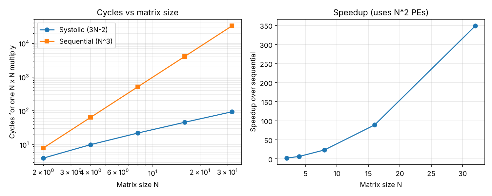

# Systolic Array Matrix Multiplier

A parameterizable N×N **output-stationary systolic array** in Verilog that multiplies signed int8 matrices with int32 accumulation, with a self-checking testbench and a cycle-accurate Python model.

## Why I built this
Matrix multiplication is the core operation in machine-learning accelerators such as Google's TPU. A systolic array does it with a grid of simple multiply-accumulate units that pass data to their neighbors, so no unit needs to read from a large shared memory. I built one to learn how hardware exploits parallelism and data reuse.

## How it works
```
        b0   b1   b2        (columns of B enter from the top,
         |    |    |         column j delayed j cycles)
 a0 -> [PE]->[PE]->[PE]
         |    |    |
 a1 -> [PE]->[PE]->[PE]     (rows of A enter from the left,
         |    |    |         row i delayed i cycles)
 a2 -> [PE]->[PE]->[PE]
```
- Each **PE** multiplies its two inputs every cycle, adds the product to a local accumulator, and passes both inputs on (one register delay) to the right and downward.
- PE(i,j) accumulates C[i][j]. It sees A[i][k] and B[k][j] together at cycle `t = i + j + k`, so the skewed inputs line up automatically.
- The last PE finishes at cycle 3N−3, so one multiply takes **3N−2 cycles**.

## Files
| Path | Description |
|---|---|
| `src/pe.v` | Processing element (multiply-accumulate + pass-through registers) |
| `src/systolic_array.v` | N×N array built with `generate` loops |
| `tb/tb_systolic_array.v` | Self-checking testbench, 100 random matrices per run |
| `scripts/model.py` | Cycle-accurate Python model, expected results, and plot |

## Run it
Install [Icarus Verilog](https://steveicarus.github.io/iverilog/) and (optionally) GTKWave.
```
make sim            # N = 4
make sim N=8        # any size
make wave           # view waveforms in GTKWave
python3 scripts/model.py    # regenerate the results table and plot
```
Expected output ends with: `PASS: all 100 tests matched the reference`.

## Results
Cycles for one N×N multiply, compared with a sequential baseline that does one multiply-accumulate per cycle (N³ cycles):

| N | PEs | Systolic cycles (3N-2) | Sequential cycles (N^3) | Speedup | PE utilization |
|---|-----|------------------------|-------------------------|---------|----------------|
| 2 | 4 | 4 | 8 | 2.0x | 50% |
| 4 | 16 | 10 | 64 | 6.4x | 40% |
| 8 | 64 | 22 | 512 | 23.3x | 36% |
| 16 | 256 | 46 | 4096 | 89.0x | 35% |
| 32 | 1024 | 94 | 32768 | 348.6x | 34% |



**Findings**
- Latency grows linearly (3N−2) while the sequential baseline grows cubically (N³).
- The speedup is not free: it uses N² PEs. Utilization of those PEs settles near 33%, because during fill and drain only part of the array is busy. Streaming matrices back to back would raise it toward 100%.

## Limitations
- Inputs are skewed by the testbench, not by a hardware controller.
- Computes one N×N multiply at a time; no tiling for larger matrices, no overflow handling beyond the 32-bit accumulator.
- Simulation only (not synthesized or run on an FPGA).

## Possible extensions
Add a hardware input-skew controller, support back-to-back matrices, synthesize with Yosys to compare area as N grows, or run it on an FPGA.
